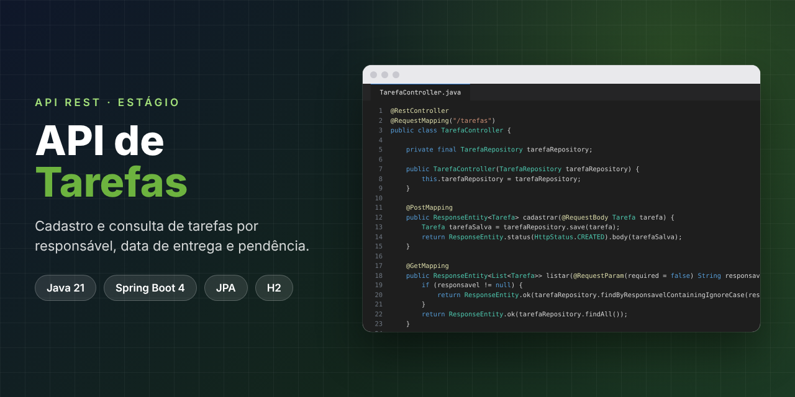
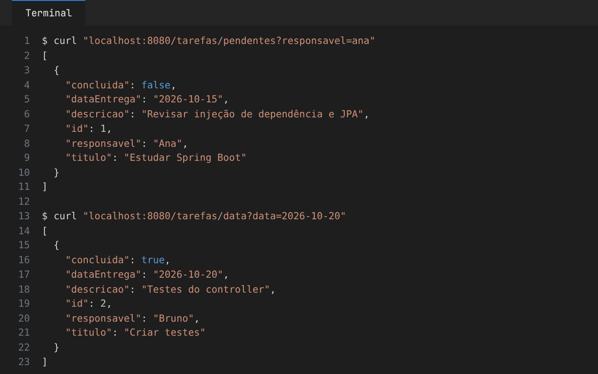
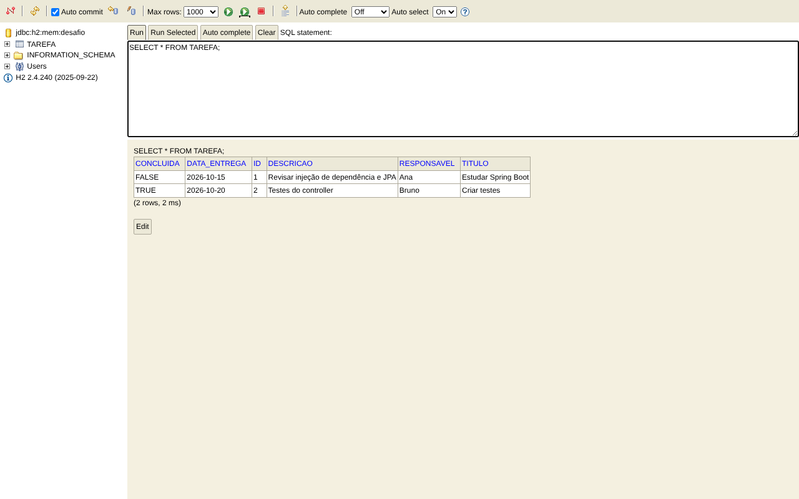

<p align="center">
  
</p>

<h1 align="center">✅ API de Tarefas</h1>

<p align="center">
  API REST em <b>Spring Boot</b> para cadastrar tarefas e consultá-las por <b>responsável</b>,
  <b>data de entrega</b> e <b>pendência</b>, com banco <b>H2</b> em memória (não precisa instalar banco nenhum).
</p>

<p align="center">
  
  
  
  
  
</p>

<p align="center">
  <a href="#-sobre-o-projeto">Sobre</a> •
  <a href="#-funcionalidades">Funcionalidades</a> •
  <a href="#-endpoints">Endpoints</a> •
  <a href="#-telas">Telas</a> •
  <a href="#-como-executar">Como executar</a> •
  <a href="#-testes">Testes</a> •
  <a href="#-estrutura-do-projeto">Estrutura</a>
</p>

---

## 📌 Sobre o projeto

Projeto feito como desafio de **estágio**: uma API REST simples e direta para o gerenciamento de tarefas. Cada tarefa
tem título, descrição, responsável, data de entrega e a indicação se já foi concluída.

A aplicação usa a estrutura clássica do Spring (`controller` → `repository` → `entity`), e as consultas são
geradas pelo **Spring Data JPA** a partir do nome dos métodos do repositório (ex.:
`findByConcluidaFalseAndResponsavelContainingIgnoreCase`). Os dados ficam num banco **H2 em memória**, recriado a
cada inicialização.

## ✨ Funcionalidades

| | Recurso | Descrição |
|---|---|---|
| ➕ | **Cadastrar tarefa** | Recebe a tarefa em JSON e devolve `201 Created` com o `id` gerado |
| 📋 | **Listar tarefas** | Lista todas ou filtra pelo responsável (parte do nome, sem diferenciar maiúsculas) |
| 📅 | **Buscar por data** | Tarefas com uma data de entrega específica |
| ⏳ | **Pendentes** | Tarefas com `concluida = false`, com filtro opcional por responsável |
| 🗄️ | **Console do H2** | Consulta o banco pelo navegador em `/h2-console` |

## 🔌 Endpoints

### 1. Cadastrar tarefa
- **Rota:** `POST /tarefas`
- **Corpo da requisição (JSON):**
  ```json
  {
    "titulo": "Estudar Spring Boot",
    "descricao": "Revisar conceitos de injeção de dependência e JPA",
    "responsavel": "Ana",
    "dataEntrega": "2026-10-15",
    "concluida": false
  }
  ```
- **Resposta:** `201 Created` com a tarefa salva.

### 2. Listar tarefas
- **Rota:** `GET /tarefas`
- **Parâmetro opcional:** `responsavel` (filtra as tarefas cujo responsável contém o texto informado).
- **Exemplo:** `/tarefas?responsavel=ana`
- **Resposta:** `200 OK` com a lista em JSON.

### 3. Buscar tarefas por data
- **Rota:** `GET /tarefas/data`
- **Parâmetro obrigatório:** `data` no formato `AAAA-MM-DD`.
- **Exemplo:** `/tarefas/data?data=2026-10-15`
- **Resposta:** `200 OK`.

### 4. Listar tarefas pendentes
- **Rota:** `GET /tarefas/pendentes`
- **Parâmetro opcional:** `responsavel`.
- **Exemplo:** `/tarefas/pendentes?responsavel=ana`
- **Resposta:** `200 OK`.

## 🖼️ Telas

<table>
  <tr>
    <td align="center"><b>Requisições com curl</b><br></td>
    <td align="center"><b>Console do H2</b><br></td>
  </tr>
</table>

## 🚀 Como executar

**Pré-requisito:** JDK 21. O Maven Wrapper (`mvnw`) já vem no projeto.

```bash
git clone https://github.com/kauaxp77/Tarefas_api.git
cd Tarefas_api
./mvnw spring-boot:run
```

Ou gere o `.jar` e rode:

```bash
./mvnw -DskipTests package
java -jar target/estagio-0.0.1-SNAPSHOT.jar
```

A API sobe em `http://localhost:8080`. Exemplo de uso:

```bash
curl -X POST localhost:8080/tarefas -H "Content-Type: application/json" \
  -d '{"titulo":"Estudar Spring Boot","descricao":"Revisar JPA","responsavel":"Ana","dataEntrega":"2026-10-15","concluida":false}'

curl "localhost:8080/tarefas/pendentes?responsavel=ana"
```

**Console do H2:** acesse `http://localhost:8080/h2-console` com a JDBC URL `jdbc:h2:mem:desafio`, usuário `sa` e
senha em branco.

## ✅ Testes

O projeto tem um teste de contexto (`EstagioApplicationTests`) que verifica se a aplicação sobe corretamente:

```bash
./mvnw test
```

## 📁 Estrutura do projeto

```
Tarefas_api/
├── src/main/java/com/example/estagio/
│   ├── EstagioApplication.java        # Classe principal
│   ├── controller/TarefaController.java  # Endpoints /tarefas
│   ├── entity/Tarefa.java             # Entidade JPA
│   └── repository/TarefaRepository.java  # Consultas do Spring Data JPA
├── src/main/resources/
│   └── application.properties         # H2 em memória e console
├── src/test/java/…/EstagioApplicationTests.java
├── docs/
│   ├── banner.png
│   └── screenshots/
├── mvnw / mvnw.cmd                    # Maven Wrapper
└── pom.xml
```

## 🛠️ Tecnologias

- **Java 21**
- **Spring Boot 4.1** (Web MVC e Data JPA)
- **H2 Database** (em memória) e **H2 Console**
- **Maven** (com Maven Wrapper)
- **JUnit 5** e **Spring Boot Test**

## 👨‍💻 Autor

Desenvolvido por **[kauaxp77](https://github.com/kauaxp77)**

<p align="center">⭐ Se curtiu o projeto, deixe uma estrela!</p>
